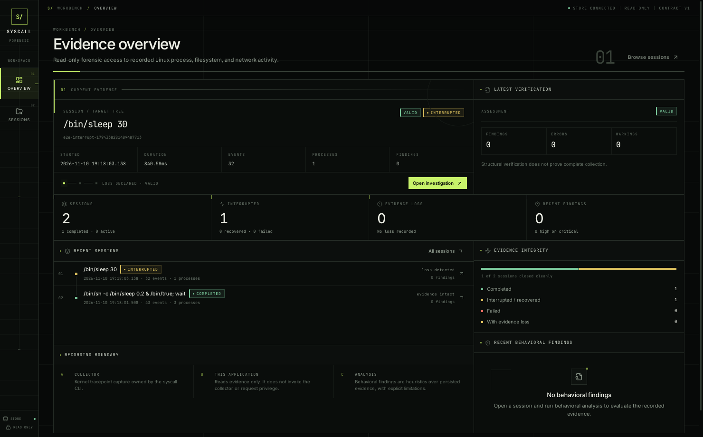
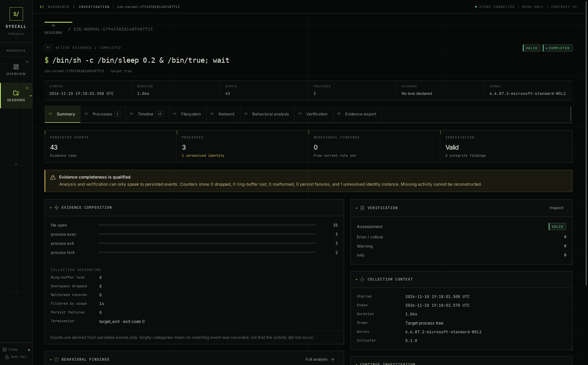

# SYSCALL

**SYSCALL** is a Linux process intelligence / runtime forensics project focused on *real* kernel telemetry (no synthetic/mock event pipelines presented as reality). It collects process lifecycle, filesystem, and network activity from eBPF tracepoints, normalizes it in userspace, persists it to SQLite, and exposes inspection via a CLI.

> **Scope:** real telemetry only. Phase 5 adds `openat(2)` file-open attempts and IPv4/IPv6 `connect(2)` attempts on top of process lifecycle. Phase 6 adds read-only, explainable behavioral analysis over that persisted evidence. Phase 7 adds a read-only Tauri desktop investigation workbench over the same databases. Only `openat` is captured (not `open`/`openat2` or write/rename/unlink), and connect events prove attempts, not established TCP sessions. Paths, addresses, flags, and raw results are recorded; file contents, packet payloads, DNS names, and environment variables are not.

## Current status (honest)

| Area | Status | Notes |
|---|---|---|
| Non-privileged quality gate | **PASS (in this workspace)** | `cargo fmt --all --check`, `cargo clippy --workspace --all-targets -- -D warnings`, `cargo test --workspace`, `cargo build -p syscall-cli`, and `scripts/check.sh` passed (includes eBPF object build/skeleton generation and BTF tracepoint layout checks). |
| Real kernel BPF load/attach/capture | **PASS (operator-run, WSL2, 2026-11-10)** | Privileged `scripts/e2e-root.sh` loaded and attached all seven tracepoints; lifecycle and Phase 5 sessions persisted real kernel events. |
| Identity integrity (raw ↔ observer ↔ canonical) | **PASS (live e2e + unit tests)** | Live exec/exit rows carried raw/observer/canonical identity and PID-reuse-safe process instances; fork buffering and reuse edge cases remain unit-tested. |
| Graceful SIGINT/SIGTERM handling | **PASS (live e2e + unit tests)** | Privileged SIGINT run exited `130`, finalized as `interrupted`, and cleaned up the target. |
| Filesystem activity (`openat`) | **PASS (live e2e)** | Real pair-attributed events, including `/etc/hostname` success; raw path, flags, dirfd, result/success/errno, truncation and relative-path limitations explicit. |
| Network activity (IPv4/IPv6 `connect`) | **PASS (live e2e)** | Real IPv4 `127.0.0.1:1` and IPv6 `::1:1` connects recorded with result `-111`; attempt-only semantics, no TCP/UDP distinction. |
| Behavioral analysis (Rules A–F) | **PASS (offline tests)** | Deterministic, read-only findings over real temporary SQLite evidence; no privileged live validation is claimed for the analysis engine. See [docs/ANALYSIS.md](docs/ANALYSIS.md). |
| Desktop workbench (Phase 7) | **PASS (release build + WSLg run)** | Tauri 2/React workbench built and launched under WSLg against a real recorded session; 30 frontend tests and 8 real-SQLite desktop service tests pass. Read-only by design, with no GUI recording controls. See [docs/DESKTOP.md](docs/DESKTOP.md). |

**Privileged validation completed on 2026-11-10.** The lifecycle e2e passed; Phase 5 runs persisted 72 events (64 file opens, 1 IPv4 connect) and 315 events (2 connects: IPv4 and IPv6). Both verified `valid` with zero findings.

## What SYSCALL does

- Attaches C eBPF tracepoint programs (libbpf-rs skeleton): scheduler `sched_process_exec`, `sched_process_fork`, `sched_process_exit`; syscall `sys_enter_openat`/`sys_exit_openat` and `sys_enter_connect`/`sys_exit_connect`.
- Pairs syscall enter/exit events in bounded LRU maps (8192 entries each), emitting one activity event at exit with the raw result. A missing enter/exit or map eviction produces no event; nothing is fabricated.
- Sends fixed-size, versioned samples through a BPF ring buffer (4 MiB).
- Decodes every field defensively; malformed samples are counted and discarded (never panic the recorder).
- Uses `ns_tgid` (observer/collector PID-namespace TGID via `bpf_get_ns_current_pid_tgid` + configured observer PID namespace map) to correlate events when BPF and userspace observe different PID namespace ID spaces (common on WSL2/rootless/container setups).
- Attributes **target-tree** scope in userspace using tracked lineage/procfs ancestry. Tracepoints are system-wide; attribution is explicit and does not weaken scope filtering.
- Tracks PID reuse with boot-scoped process-instance IDs (`boot_id:pid:start_time_ticks`, with explicit fallback when start time is unavailable).
- Persists sessions and events to SQLite in batched transactions with schema versioning and restrictive permissions.
- Exposes CLI commands: `info`, `record`, `sessions`, `inspect`, `events`, `processes`, `tree`, `timeline`, `files`, `connections`, `stats`, `verify`, `analyze`, `export` (investigation and read-only forensic workflows; see [docs/INVESTIGATION.md](docs/INVESTIGATION.md), [docs/ANALYSIS.md](docs/ANALYSIS.md), [docs/EVIDENCE_EXPORT.md](docs/EVIDENCE_EXPORT.md), [docs/VERIFICATION.md](docs/VERIFICATION.md)).
- Drops root privilege after loading/attaching BPF (when started via sudo), before creating the database or spawning the target, so recordings are owned by the invoking user.

## Key design: identity model (important)

SYSCALL distinguishes three identity spaces:

1. **Raw BPF identity** — kernel/BPF-observed identifiers from the event header/context (`pid/tgid/tid/ppid`, etc.). May be in a different PID namespace than the collector’s observer `/proc`.
2. **Observer-visible identity** — identifiers visible in the collector’s own `/proc`/PID namespace. When available, this is correlated from `ns_tgid` (and validated/canonicalized in userspace scope/procfs logic).
3. **Canonical process identity** — the application identity used consistently for attribution, relationships, storage, inspection, and process-instance IDs.
   - When namespace correlation/observer identity is established, **canonical = observer-visible**. `Event.pid/tid/ppid` and `process_instance_id` are persisted in that canonical space.
   - Raw BPF IDs are retained as diagnostic detail (e.g., `raw_bpf` debug identity chain; `ProcessExec.old_pid` remains a BPF detail).

### Fork handling (current limitation + safe behavior)

The BPF fork handler currently emits child `ns_tgid=0` (wire layout unchanged). Because raw child TGID may not equal observer-visible PID across namespaces, SYSCALL **does not fabricate** canonical fork identity:
- If child `ns_tgid` is available, it is used.
- Otherwise it may attempt a *verified* procfs fallback only when safe (same-namespace/process-leader evidence matches tracked canonical parent).
- If still unresolved, the fork is registered as **provisional** (lineage-admitted only; scope not weakened) and **buffered in memory** — not persisted with guessed canonical identity.
- When a later child exec/exit arrives with child-context `ns_tgid`, the provisional identity is upgraded to canonical observer identity, the raw→canonical alias is learned, and the buffered fork is flushed **before** the current event with the same canonical `process_instance_id` and original fork timestamps.
- If correlation is never observed before session end, unresolved buffered forks are flushed with explicit raw/provisional identity (honest limitation, no fabrication).

PID-reuse protection is preserved (boot-scoped instance IDs, start-time checks, no admission by name/path).

## Schema versions

These are intentionally separate:

| Contract | Version | Where |
|---|---:|---|
| BPF ring-buffer **wire schema** | `3` (decoder accepts `1`/`2` only for process lifecycle) | `ebpf/syscall_event.h` (`SYSCALL_EVENT_VERSION`), `syscall-collector::event_decoder::WIRE_SCHEMA_VERSION` |
| Core/domain/session event-payload schema | `1` | `syscall-core::event::SCHEMA_VERSION`, session/storage model |
| SQLite schema (`PRAGMA user_version`) | `4` | `syscall-storage` migrations (`001`–`004`) |

`syscall info` reports core and BPF wire schema separately to avoid confusion.

## Requirements

- Linux x86_64 with BPF, BTF, tracefs, and ring-buffer-capable kernel (>= 5.8 typical).
- Rust stable toolchain (workspace MSRV declared in `Cargo.toml`; tested with recent stable).
- `clang`, libbpf headers/library, `pkg-config` (for eBPF build/skeleton generation). No `bpftool` required for the normal build path.
- For the desktop workbench: Node.js 20+, WebKitGTK 4.1, GTK 3, and the other Tauri Linux prerequisites. See [docs/DESKTOP.md](docs/DESKTOP.md) for the exact Ubuntu/WSL2 packages and WSLg notes.
- Privileges **only** for `syscall record`: root or `CAP_BPF` + `CAP_PERFMON` (or `CAP_SYS_ADMIN` on older setups). Inspection commands do not require privilege. The desktop workbench never records or requests privilege.

## Build

```bash
cargo build --workspace
# release
cargo build --release
# CLI only
cargo build -p syscall-cli
```

Standalone eBPF object + section check:

```bash
make -C ebpf clean check
```

Desktop workbench (from the repository root):

```bash
cd desktop
npm install
npm run tauri:dev    # development window (Vite + Tauri)
npm run tauri:build  # release bundle
# binary-only release without packaging
npm run tauri:build -- --no-bundle
```

The release binary is `target/release/syscall-workbench`. Open a recorded database read-only:

```bash
target/release/syscall-workbench --db="$HOME/.local/share/syscall/e2e-<id>.db"
```

### Desktop screenshots (real recorded session)

Captured from the release binary under WSLg using the recorded
`e2e-normal-1794338281489487713` session (43 events, 3 processes). These are not mockups.





See [docs/DESKTOP.md](docs/DESKTOP.md) for the session browser, process tree, timeline,
filesystem, network, behavioral analysis, verification, and export screenshots, plus the full
architecture, command contract, security model, WSL2 setup, and limitations.

## Non-privileged quality gate (no sudo)

```bash
cargo fmt --all --check
cargo clippy --workspace --all-targets -- -D warnings
cargo test --workspace
# full local gate used by this repo (includes ebpf/skeleton/BTF checks)
./scripts/check.sh
```

The workspace commands include the Tauri crate and therefore need the desktop prerequisites in
[docs/DESKTOP.md](docs/DESKTOP.md). Without them, `scripts/check.sh` automatically checks the
command-independent desktop service layer headlessly and reports that the GUI was skipped.

## Quick start

Inspect environment (no privilege):

```bash
target/debug/syscall info
# JSON
target/debug/syscall info --json
```

Record a target tree (**operator runs this manually with privilege; SYSCALL never invokes sudo/prompts for passwords**):

```bash
sudo target/debug/syscall record -- /usr/bin/sleep 5
```

Inspect as a normal user:

```bash
target/debug/syscall sessions
target/debug/syscall inspect <SESSION_ID>
target/debug/syscall events <SESSION_ID>
# JSON/examples
target/debug/syscall sessions --json
target/debug/syscall inspect <SESSION_ID> --json
target/debug/syscall events <SESSION_ID> --type process_exec --json
```

Investigation and export (read-only over recorded evidence):

```bash
# process instances, hierarchy, timeline, and statistics
syscall processes <SESSION_ID>
syscall tree <SESSION_ID>
syscall timeline <SESSION_ID> --type process_exec --pid 1234 --limit 100
syscall timeline <SESSION_ID> --from 2026-01-02T00:00:00Z --to 2026-01-02T01:00:00Z --json
syscall files <SESSION_ID> --pid 1234 --result failure
syscall connections <SESSION_ID> --family ipv6 --result success --json
syscall stats <SESSION_ID> --verify

# explainable behavioral findings over persisted evidence (read-only)
syscall analyze <SESSION_ID>
syscall analyze <SESSION_ID> --rule SYSCALL-TEMP-EXEC --json
syscall analyze <SESSION_ID> --severity high --min-confidence medium
syscall analyze <SESSION_ID> --config ./analysis.json --output ./analysis.txt

# deterministic JSON evidence export with SHA-256 manifest
syscall export <SESSION_ID> --format json --output ./evidence-<SESSION_ID>.json
# refuse overwrite by default; allow explicit overwrite
syscall export <SESSION_ID> --format json --output ./evidence.json --force
```

See [docs/INVESTIGATION.md](docs/INVESTIGATION.md) for the investigation workflow, [docs/ANALYSIS.md](docs/ANALYSIS.md) for every rule/configuration/finding contract, and [docs/EVIDENCE_EXPORT.md](docs/EVIDENCE_EXPORT.md) for export format, manifest hashing, determinism, and privacy guarantees.

Useful variants:

```bash
# Target tree (default semantics)
sudo target/debug/syscall record --scope target-tree -- /usr/bin/sleep 5

# System-wide lifecycle observation
sudo target/debug/syscall record --scope system -- /usr/bin/sleep 5

# Redact target arguments
sudo target/debug/syscall record --redact-args -- /usr/bin/curl https://example.com

# Explicit DB/session
sudo target/debug/syscall record --db /tmp/syscall.db --session-id demo-1 -- /bin/true
```

### Exit codes (record)

- Mirrors the target’s exit code when recording succeeds and the recorder was not interrupted.
- Recorder interruption: **130** for SIGINT (`Ctrl+C`), **143** for SIGTERM (conventional `128 + signal`).
- Signalled target: `128 + target_signal` (when applicable).
- Recording/finalization failures return non-zero with an error.

On interruption, the recorder stops accepting work, handles ring-buffer polling `EINTR` safely when shutdown is requested, performs a best-effort drain, flushes/finalizes the session as `interrupted` (or accurately reported equivalent), cleans up BPF/target resources, and exits with the signal-appropriate code.

## Privileged end-to-end validation (manual, operator-run)

> **Do not run via automation that assumes sudo access.** Run manually when you have the required privileges.

```bash
cd ~/code/syscall   # or your checkout path
cargo build -p syscall-cli
sudo env RUST_LOG=debug scripts/e2e-root.sh 2>e2e-debug.log
```

What to verify after a privileged run:
- BPF loads/attaches; events are real kernel telemetry (not synthetic).
- Identity chain is consistent when `ns_tgid` correlation is present (`raw_bpf -> ns_tgid/canonical -> persisted` in debug logs); no duplicate processes caused only by raw vs observer PID differences; exec/exit share the same `process_instance_id` for a process instance.
- Target-tree scope contains target lineage only (system-wide BPF observation is filtered in userspace; harness helpers may appear in debug logs as rejected, but must not be persisted/attributed).
- Interrupt test: exit `130`, session `interrupted` and inspectable, DB valid, target cleaned up (no orphan). No fatal `BPF runtime error: Interrupted system call` when shutdown was requested.
- `syscall info` shows **core schema** and **BPF wire schema** separately.

Optional manual checks:
```bash
# send SIGTERM to a running recorder (confirm 143) — do only if appropriate
# syscall sessions / inspect / events for recorded sessions
```

## Project structure

| Path | Purpose |
|---|---|
| `ebpf/syscall.bpf.c` | C eBPF tracepoint programs, ring buffer, loss/helper stats maps |
| `ebpf/syscall_event.h` | Fixed wire format shared with Rust decoder (wire v3) |
| `ebpf/Makefile` | Standalone eBPF compile/check |
| `crates/syscall-core/` | Domain model, schema/validation, IDs (PID-reuse), scope vocabulary, clocks, paths, analysis result model |
| `crates/syscall-storage/` | SQLite schema/migrations, batched inserts, read-only queries |
| `crates/syscall-analysis/` | Deterministic behavioral rules A–F, evidence context, strict config, report assembly |
| `crates/syscall-export/` | Shared deterministic JSON evidence export and SHA-256 manifest (used by CLI and desktop) |
| `desktop/` | Tauri 2 + React + TypeScript read-only investigation workbench |
| `crates/syscall-collector/` | BPF skeleton load/attach, strict decoder, scope/identity, procfs, writer, orchestration, signals |
| `crates/syscall-cli/` | Clap CLI, text/JSON rendering, exit-code policy |
| `scripts/check.sh` | Non-privileged quality gate |
| `scripts/e2e-root.sh` | Operator-run privileged end-to-end test (requires sudo) |
| `scripts/check-btf-layout.sh` | Tracepoint context layout check against kernel BTF |
| `scripts/env-audit.sh` | Read-only environment audit (no sudo) |
| `docs/` | Architecture, event schema, WSL compatibility, security, development, roadmap, investigation, analysis, evidence export, verification, desktop workbench |

## Security / safety properties

- No automatic privilege escalation and no password handling.
- BPF load/attach occur while privileged; process drops to invoking user (sudo context) before DB creation/target spawn; DB directory/file use restrictive permissions.
- SQL uses bound parameters; decoder is strict/bounds-checked; kernel strings/control chars are handled defensively (escaped in terminal output).
- Bounded queues/ring-buffer handling; malformed samples and drops/loss are counted.
- Target-tree scope is enforced by userspace attribution logic and must **not** be weakened to “make events appear.” Unknown/unverifiable identities are not fabricated as canonical.
- File-open and connect telemetry is collected; `--redact-args` can avoid persisting target arguments but does not redact file paths or network destinations.
- The desktop renderer has one typed Tauri IPC boundary, no SQL, no shell/filesystem/dialog/HTTP plugins, a `core:default`-only capability, a restrictive CSP, and a backend-fixed read-only database path and export destination. It never invokes `sudo` or the collector.

See [docs/SECURITY.md](docs/SECURITY.md), [docs/WSL_COMPATIBILITY.md](docs/WSL_COMPATIBILITY.md), and [docs/DESKTOP.md](docs/DESKTOP.md).

## Known limitations / troubleshooting notes

- **Privileged e2e required for proof:** non-privileged tests and `scripts/check.sh` do not prove kernel load/attach/runtime correctness.
- **WSL2/PID namespaces:** raw BPF TGIDs may differ from observer-visible PIDs; `ns_tgid` correlation is essential. Tracefs permissions, `unprivileged_bpf_disabled`, memlock/rlimits, and BTF availability are environment-dependent (`syscall info` helps diagnose).
- **Fork `ns_tgid=0` (BPF context limitation):** canonical fork identity may be deferred until child exec/exit; unresolved forks are buffered/flushed safely without fabricating canonical IDs. A future CO-RE/task-aware BPF improvement may help (careful wire/compat review required).
- **Target-tree scope is userspace attribution, not kernel-side filtering.** Tracepoints observe system-wide; out-of-scope events are filtered and counted.
- **Timestamps:** derived wall-clock uses a captured monotonic→realtime offset; prefer `monotonic_ns` for ordering/correlation.
- **Open/connect coverage is partial:** only `openat` and `connect` are hooked; `open`, `openat2`, write/rename/unlink, `sendto`/`sendmsg`, and `accept` are not. Paths are raw (relative directories unresolved), source addresses are usually unavailable, and `connect` success is not an established-connection claim.
- **Behavioral analysis is not a verdict:** findings are deterministic indicators tied to recorded events. Confidence is not a calibrated probability, and the engine never claims exfiltration, malware, or file transmission. Missing ancestry/losses limit negative conclusions. Analysis is offline and read-only; no privileged live validation is claimed for it.
- **Desktop workbench is read-only and unbundled in this workspace:** recording remains a CLI/operator workflow because a safe privileged helper does not exist. The release binary was validated with locally staged Ubuntu 24.04 Tauri dependencies because the host lacked the system `-dev` packages; install the prerequisites in [docs/DESKTOP.md](docs/DESKTOP.md) for a normal build. No installer, signature, or packaged app bundle is claimed.
- **Pairing loss is not separately counted:** a missing syscall enter/exit or LRU map eviction yields no event, while ring-buffer and userspace drops are counted.
- If you hit `BPF runtime error: Interrupted system call` on interrupt, ensure you are running a build with the EINTR/shutdown handling fix and re-run privileged e2e.

## For future development (quick map)

- **Identity/scope bugs:** start at `crates/syscall-collector/src/collector.rs` (`build_event`, fork buffering/flush, identity-chain logs), `crates/syscall-collector/src/scope.rs` (provisional/alias/lineage/PID reuse), and `procfs.rs`.
- **BPF/wire changes:** coordinate `ebpf/syscall_event.h`, `ebpf/syscall.bpf.c`, `syscall-collector/src/event_decoder.rs`, and docs; preserve compatibility or document migration explicitly.
- **Signal/finalization bugs:** `syscall-collector/src/signal.rs`, ring-buffer poll loop in `collector.rs`, writer/session finalization, CLI `record_exit_code`, and `scripts/e2e-root.sh`.
- **Storage/schema changes:** add migrations; never silently reinterpret schema versions.

## License

MIT — see [LICENSE](LICENSE).
