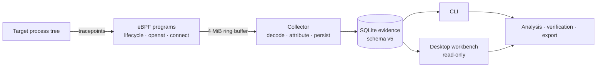

<h1 align="center">SYSCALL</h1>

<p align="center"><strong>Runtime forensics for Linux, built on real kernel telemetry.</strong></p>

<p align="center">
  <a href="https://github.com/dustin04x/syscall/actions/workflows/ci.yml"></a>
  
  
  
  
</p>

<p align="center">
  Record process lifecycle, file-open, and network-connect activity with eBPF.<br>
  Persist it as attributable evidence. Investigate it from the CLI or a read-only desktop workbench.
</p>

<p align="center">
  
</p>

> **Scope, stated plainly:** SYSCALL records real kernel telemetry. It does not present mock or synthetic event pipelines as evidence. Collection covers process lifecycle, `openat(2)` attempts, and IPv4/IPv6 `connect(2)` attempts. File contents, packet payloads, DNS names, and environment variables are never captured. A successful `connect` proves an attempt, not an established session.

## Contents

- [Overview](#overview)
- [Documentation](#documentation)
- [Quick start](#quick-start)
- [How it works](#how-it-works)
- [CLI at a glance](#cli-at-a-glance)
- [Validation status](#validation-status)
- [Security and privacy](#security-and-privacy)
- [Known limitations](#known-limitations)
- [Repository layout](#repository-layout)
- [Development](#development)
- [License](#license)

## Overview

SYSCALL is a local runtime forensics tool for Linux. It captures kernel-level activity from eBPF tracepoints, stores it in a versioned SQLite evidence database, and exposes read-only investigation through a CLI and a desktop workbench.

| Principle | What it means in practice |
|---|---|
| **Real telemetry** | Events come from seven eBPF tracepoints, through a versioned wire format and a bounds-checked decoder. Malformed samples are counted, never guessed at. |
| **Attribution, not decoration** | Raw BPF IDs, observer-visible IDs, and canonical process identities are kept distinct. PID reuse is handled with boot-scoped process-instance IDs. |
| **Evidence you can inspect** | Every persisted event keeps provenance. Sessions report collection accounting: ring-buffer loss, userspace drops, malformed records, scope filtering, and persist failures. |
| **Analysis that explains itself** | Deterministic rules A–F attach findings to supporting events and processes, with confidence, limitations, and next steps. A finding is an observation, not a verdict. |
| **Read-only investigation** | The desktop workbench has one typed Tauri IPC boundary, no SQL, no shell, no filesystem plugins, and no recording controls. The backend fixes the database and export paths. |
| **Honest edges** | Missing data stays missing. Fork identity is buffered rather than fabricated. Failed opens remain evidence. Capture coverage and known blind spots are documented. |

### Interface preview

The desktop app and standalone renderer share the same React UI. These captures use the renderer's deterministic preview dataset and label the contract as `ui-preview`; they document the interface, not a live recording. Live capture validation is reported in [Validation status](#validation-status).

| Investigation summary | Behavioral analysis |
|:---:|:---:|
|  |  |
| Identity, collection accounting, evidence composition, and verification at a glance. | Explainable findings with severity, confidence, evidence links, and related processes. |

| Session timeline | Evidence export |
|:---:|:---:|
|  |  |
| Event density over time, filtering, and full payload provenance for a selected event. | Deterministic JSON bundle with a per-component SHA-256 manifest. |

More screens: [Workbench guide](docs/guides/workbench.mdx#screens) (session browser, process tree, filesystem, network, verification, export confirmation).

### Architecture



The collector loads and attaches BPF programs while privileged, drops to the invoking user, then creates the database and spawns the target. Tracepoints are system-wide; target-tree scope is enforced in userspace and every filtered event is accounted for.

## Documentation

The full documentation lives in [`docs/`](docs/) as a Mintlify site (`docs/docs.json`).

**Preview locally**

```bash
cd docs
npx --yes mint@latest dev --no-open
```

### Get started
- [Overview](docs/index.mdx) — what SYSCALL records and how to navigate the docs
- [Quickstart](docs/quickstart.mdx) — build, record, inspect, analyze, verify, export
- [Installation](docs/installation.mdx) — prerequisites, host packages, BTF checks, paths

### Concepts
- [How SYSCALL works](docs/concepts/how-it-works.mdx) — tracepoints, decoding, recording, storage
- [Identity and scope](docs/concepts/identity-and-scope.mdx) — identity spaces, process instances, fork buffering
- [Evidence model](docs/concepts/evidence-model.mdx) — session states, event meaning, counters, completeness

### Guides
- [Record a session](docs/guides/record.mdx) — privilege, scope, redaction, signals, exit codes
- [Investigate a session](docs/guides/investigate.mdx) — processes, timeline, files, connections, statistics
- [Analyze behavior](docs/guides/analyze.mdx) — rule workflow, filters, severity, confidence
- [Verify evidence](docs/guides/verify.mdx) — read-only checks, assessments, exit codes
- [Export evidence](docs/guides/export.mdx) — deterministic packages and manifest verification
- [Desktop workbench](docs/guides/workbench.mdx) — screens, IPC contract, read-only boundary

### Reference
- [CLI reference](docs/reference/cli.mdx) — every command, option, default, filter, and exit code
- [Event and storage schema](docs/reference/schemas.mdx) — wire format, payloads, SQLite v5
- [Analysis rules](docs/reference/analysis-rules.mdx) — rules A–F, configuration, report contract
- [Export format](docs/reference/export-format.mdx) — package structure, hashing, compatibility

### Operations
- [Security and threat model](docs/operations/security.mdx) — privilege model, boundaries, data handling
- [Known limitations](docs/operations/limitations.mdx) — coverage and integrity limits
- [WSL2 compatibility](docs/operations/wsl.mdx) — observed environment and privileged validation
- [Troubleshooting](docs/operations/troubleshooting.mdx) — host, BPF, database, and desktop issues

### Project
- [Architecture](docs/project/architecture.mdx) — crates, kernel surface, concurrency, tradeoffs
- [Development](docs/project/development.mdx) — setup, checks, eBPF workflow, privileged testing
- [Testing and validation](docs/project/testing.mdx) — test layers and validation status
- [Roadmap](docs/project/roadmap.mdx) — delivered phases and open work

## Quick start

### Requirements

| Area | Requirements |
|---|---|
| **Runtime** | Linux x86_64, kernel with BPF, BTF, tracefs, and ring-buffer support (5.8+ typical) |
| **Build** | Rust 1.82+, `clang`, libbpf headers/library, `pkg-config` |
| **Desktop** | Node.js 20+, WebKitGTK 4.1, GTK 3, and other [Tauri Linux prerequisites](docs/guides/workbench.mdx#build-the-workbench) |
| **Privilege** | `record` only: root or `CAP_BPF` + `CAP_PERFMON` (or `CAP_SYS_ADMIN` on older kernels) |

Inspection, analysis, verification, export, and the desktop workbench require no privilege.

### Build

```bash
cargo build --workspace
cargo build --release -p syscall-cli

# eBPF object and section checks
make -C ebpf clean check
```

### Record and inspect

```bash
# Diagnose the environment without privilege
target/release/syscall info
target/release/syscall info --json

# Record a target tree (operator-run; SYSCALL never escalates privileges itself)
sudo target/release/syscall record -- /usr/bin/sleep 5

# Inspect as a normal user
target/release/syscall sessions
target/release/syscall inspect <SESSION_ID>
target/release/syscall timeline <SESSION_ID> --limit 100
target/release/syscall analyze <SESSION_ID>
target/release/syscall verify <SESSION_ID>
target/release/syscall export <SESSION_ID> --format json --output ./evidence-<SESSION_ID>.json
```

### Open the workbench

```bash
cd desktop
npm install
npm run tauri:dev
# or: npm run tauri:build -- --no-bundle
```

Open a recorded database read-only:

```bash
target/release/syscall-workbench --db="$HOME/.local/share/syscall/<session>.db"
```

## How it works

### Collection

- **Scheduler tracepoints:** `sched_process_exec`, `sched_process_fork`, `sched_process_exit`.
- **Syscall tracepoints:** `sys_enter_openat`/`sys_exit_openat` and `sys_enter_connect`/`sys_exit_connect`.
- **Pairing:** enter/exit pairs are matched in bounded LRU maps (8192 entries each). A missing side or eviction produces no event; nothing is fabricated.
- **Transport:** fixed-size, versioned samples cross a 4 MiB BPF ring buffer. Decoding is strict and bounds-checked.
- **Correlation:** `ns_tgid` correlates events when BPF and userspace see different PID namespaces (common on WSL2, rootless, and container hosts).
- **Scope:** target-tree scope is attributed in userspace from tracked lineage and procfs ancestry. Out-of-scope events are filtered and counted, never silently dropped.

### Identity model

SYSCALL keeps three identity spaces deliberately separate:

1. **Raw BPF identity** — kernel-observed identifiers from the event header and context.
2. **Observer-visible identity** — identifiers visible in the collector's own `/proc` and PID namespace, correlated through `ns_tgid` where available.
3. **Canonical process identity** — the persisted identity used for attribution, relationships, storage, and inspection. When correlation is established, canonical equals observer-visible. Raw IDs remain diagnostic provenance.

Process instances are boot-scoped (`boot_id:pid:start_time_ticks`) so PID reuse cannot merge unrelated processes.

<details>
<summary><strong>Fork buffering and unresolved ancestry</strong></summary>

The BPF fork handler currently emits child `ns_tgid=0`; the wire layout is unchanged. Because a raw child TGID may differ from the observer-visible PID across namespaces, SYSCALL does not invent a canonical child identity:

- If child `ns_tgid` is available, it is used.
- Otherwise a verified procfs fallback may be attempted only when same-namespace, process-leader evidence matches the tracked canonical parent.
- If identity remains unresolved, the fork is registered as **provisional** (lineage-admitted only; scope is not weakened) and buffered in memory.
- A later child exec/exit with child-context `ns_tgid` upgrades the identity, learns the alias, and flushes the buffered fork before the current event with the same canonical process-instance ID and original timestamps.
- If correlation never arrives, buffered forks are flushed at session end with explicit provisional identity. The limitation is stated, not hidden.

</details>

### Schema versions

| Contract | Version | Location |
|---|---:|---|
| BPF ring-buffer wire schema | `3` | `ebpf/syscall_event.h`, `syscall-collector::event_decoder::WIRE_SCHEMA_VERSION` |
| Core event-payload schema | `2` | `syscall-core::event::SCHEMA_VERSION` (readable: `1`–`2`) |
| SQLite schema (`PRAGMA user_version`) | `5` | `crates/syscall-storage/migrations/001`–`005` |

`syscall info` reports the core and BPF wire schemas separately.

## CLI at a glance

| Workflow | Commands |
|---|---|
| **Record** | `record` with `--scope target-tree\|system`, `--redact-args`, `--db`, `--session-id` |
| **Inspect** | `sessions`, `inspect`, `events`, `processes`, `tree`, `timeline`, `files`, `connections`, `stats` |
| **Analyze & integrity** | `analyze`, `verify` |
| **Evidence package** | `export --format json --output <path>` (SHA-256 manifest) |
| **Environment** | `info` |

**Record exit codes:** mirrors the target's exit code on success; `130` for SIGINT, `143` for SIGTERM; a signalled target yields `128 + signal`; recording/finalization failures return non-zero. On interruption the recorder stops accepting work, drains best-effort, finalizes the session accurately, and cleans up BPF and target resources.

See the full [CLI reference](docs/reference/cli.mdx) for all options, filters, defaults, and output behavior.

## Validation status

Last validated **2026-11-13**. Status labels distinguish what has actually been exercised.

| Area | Status | Evidence |
|---|---|---|
| Non-privileged quality gate | **PASS** | `scripts/check.sh` and GitHub Actions: formatting, Clippy (`-D warnings`), workspace tests, CLI/collector builds, eBPF compile/skeleton generation, desktop build and 30 renderer tests, frontend builds. |
| Live kernel load / attach / capture | **PASS** (operator-run, WSL2, 2026-11-10) | Privileged `scripts/e2e-root.sh` attached all seven tracepoints and persisted real lifecycle and Phase 5 sessions. |
| Identity integrity | **PASS** (live e2e + unit tests) | Exec/exit rows carried raw, observer, and canonical identity with PID-reuse-safe process instances. |
| Signal handling | **PASS** (live e2e + unit tests) | SIGINT exited `130`, finalized the session as `interrupted`, and cleaned up the target. |
| Filesystem activity | **PASS** (live e2e) | Pair-attributed `openat` events with raw paths, flags, results, errno, and explicit truncation/relative-path limits. |
| Network activity | **PASS** (live e2e) | Real IPv4 and IPv6 `connect` attempts recorded with `-111`; attempt-only semantics documented. |
| Behavioral analysis | **PASS** (offline tests) | Deterministic rules over real temporary SQLite evidence. No privileged live validation is claimed for the rule engine. |
| Desktop workbench | **PASS** (release build + WSLg run) | Launched against a real recorded session; 30 renderer tests and 8 real-SQLite service tests pass. Read-only by design. |

Phase 5 runs persisted **72 events** (64 file opens, 1 IPv4 connect) and **315 events** (2 connects: IPv4 and IPv6). Both verified `valid` with zero findings. CI records the BTF layout check as advisory when the runner kernel differs from the checked WSL2 kernel; the local gate still enforces it.

## Security and privacy

- **No automatic escalation.** SYSCALL never invokes `sudo`, prompts for a password, or records through the desktop app.
- **Privilege is dropped early.** BPF load/attach happen while privileged; the process becomes the invoking user before creating the database or spawning the target.
- **Narrow boundaries.** SQL uses bound parameters; decoding is strict; kernel strings and control characters are escaped for terminal output.
- **Typed, minimal desktop IPC.** One Tauri boundary, a `core:default`-only capability, restrictive CSP, and backend-fixed database/export paths. No SQL, shell, dialog, filesystem, or HTTP plugins.
- **No silent secret collection.** `--redact-args` avoids persisting target arguments, but file paths and network destinations remain evidence.
- **Read-only investigation surfaces.** Analysis and verification never mutate the database. Export writes only to the backend-selected destination and requires explicit confirmation to replace an existing file.

See [Security and threat model](docs/operations/security.mdx) and [WSL2 compatibility](docs/operations/wsl.mdx).

## Known limitations

| Limitation | Consequence |
|---|---|
| **Live proof requires privilege** | Unit tests and `scripts/check.sh` do not prove kernel load/attach/runtime correctness. The operator-run privileged e2e does. |
| **Namespace correlation** | Raw BPF TGIDs may differ from observer PIDs. `ns_tgid` is essential; tracefs permissions, `unprivileged_bpf_disabled`, memlock limits, and BTF availability are environment-dependent. |
| **Fork `ns_tgid=0`** | Canonical fork identity may wait for child exec/exit. Unresolved forks remain explicitly provisional. |
| **Scope is userspace attribution** | Tracepoints observe system-wide; out-of-scope events are filtered and counted, not hidden at the kernel boundary. |
| **Partial syscall coverage** | Only `openat` and `connect` are hooked. `open`, `openat2`, write/rename/unlink, `sendto`/`sendmsg`, and `accept` are not. Paths are raw; `connect` success is not an established-session claim. |
| **Timestamps** | Wall-clock time comes from a captured monotonic-to-realtime offset. Prefer `monotonic_ns` for ordering and correlation. |
| **Analysis is not a verdict** | Findings are deterministic indicators tied to recorded events. Confidence is not calibrated probability; missing ancestry or collection loss limits negative conclusions. |
| **Pairing loss is not separately counted** | A missing syscall enter/exit or LRU eviction yields no event; ring-buffer and userspace drops are counted separately. |
| **Workbench is unbundled and read-only** | Recording remains a CLI/operator workflow. No installer, signature, or packaged bundle is claimed. |

More detail: [Known limitations](docs/operations/limitations.mdx).

## Repository layout

| Path | Purpose |
|---|---|
| `ebpf/` | C eBPF programs, fixed wire format, standalone compile/check |
| `crates/syscall-core/` | Domain model, validation, identity IDs, scope vocabulary, clocks, paths |
| `crates/syscall-collector/` | BPF skeleton, decoder, attribution, procfs, writer, orchestration, signals |
| `crates/syscall-storage/` | SQLite migrations, batched inserts, read-only queries, verification |
| `crates/syscall-analysis/` | Deterministic rules, evidence context, strict config, report assembly |
| `crates/syscall-export/` | Shared JSON export and SHA-256 manifest |
| `crates/syscall-cli/` | Clap CLI, text/JSON rendering, exit-code policy |
| `desktop/` | Tauri 2 + React 19 + TypeScript read-only workbench |
| `ui/` | Standalone renderer/preview of the same workbench interface |
| `scripts/` | Quality gate, privileged e2e, BTF layout check, environment audit |
| `docs/` | Mintlify documentation site, guides, references, and screenshots |

## Development

```bash
# Full non-privileged gate (includes eBPF and BTF checks)
./scripts/check.sh

# Individual checks
cargo fmt --all --check
cargo clippy --workspace --all-targets -- -D warnings
cargo test --workspace
npm run build --prefix desktop
npm test --prefix desktop
npm run build --prefix ui
```

Workspace commands include the Tauri crate and need the [desktop prerequisites](docs/guides/workbench.mdx#build-the-workbench). Without them, `scripts/check.sh` checks the command-independent desktop service layer headlessly and reports that the GUI was skipped.

Privileged validation is intentionally manual:

```bash
cargo build -p syscall-cli
sudo env RUST_LOG=debug scripts/e2e-root.sh 2>e2e-debug.log
```

Verify that BPF loads and attaches, identity chains reconcile across namespaces, target-tree scope holds, interruption produces exit `130` with an inspectable session, and `syscall info` reports core and wire schemas separately.

**Where to start:** identity/scope work lives in `crates/syscall-collector/src/{collector,scope,procfs}.rs`; wire changes must coordinate `ebpf/syscall_event.h`, `ebpf/syscall.bpf.c`, the decoder, and docs; signal/finalization work starts in `signal.rs` and the ring-buffer poll loop; storage changes require a new migration, never a silent reinterpretation.

See [Development](docs/project/development.mdx) and [Architecture](docs/project/architecture.mdx) for the full workflow.

## License

MIT. See [LICENSE](LICENSE).

<p align="center"><sub>Record what happened. Keep the provenance. State the limits.</sub></p>
