# SYSCALL Workbench (Phase 7)

**Status:** release binary built, launched under WSLg, and exercised against a real recorded session. The workbench is **read-only**; recording remains a CLI/operator workflow.

The desktop application is a Tauri 2 + React + TypeScript investigation surface over the
existing SYSCALL evidence store. It does not create synthetic sessions, charts, findings, or
verification results. The release binary was validated against the persisted
`e2e-normal-1794338281489487713` session (43 events, 3 processes, kernel
`6.6.87.2-microsoft-standard-WSL2`, recorded 2026-11-10). The current interface screenshots
in section 3 were captured later from the standalone renderer's deterministic preview dataset;
they document the redesigned interface, not the live e2e recording.

| Area | Result |
|---|---|
| React/TypeScript production build | **PASS** — strict `tsc --noEmit`, Vite production build |
| Frontend tests | **PASS** — 9 files, 30 tests |
| Desktop service tests | **PASS** — 8 tests with real temporary SQLite databases |
| Tauri GUI compile/check | **PASS** — `cargo check -p syscall-desktop --all-targets` with Ubuntu 24.04 headers |
| Release build | **PASS** — `target/release/syscall-workbench` (`tauri build --no-bundle`) |
| WSLg launch | **PASS** — real window at 1480×920, software rendering |
| Interface captures | **PASS** — 11 current-design captures from the standalone renderer: Overview, Sessions, Summary, Processes, Timeline, Filesystem, Network, Behavioral analysis, Verification, Export, Export result |
| Export through the GUI | **PASS** — 64,138-byte JSON package, mode `0600`, SHA-256 manifest rendered |
| Privileged recording from the GUI | **Not implemented by design** — read-only workbench |

## 1. Environment audit

Observed at implementation time:

| Item | Value |
|---|---|
| Distribution | Ubuntu 24.04.4 LTS (WSL2) |
| Kernel | `6.6.87.2-microsoft-standard-WSL2` |
| Rust / Cargo | `1.99.1` |
| Node / npm | `20.20.2` / `10.8.2` |
| Display | WSLg, `DISPLAY=:0`, `WAYLAND_DISPLAY=wayland-0` |
| Runtime dir | `XDG_RUNTIME_DIR=/run/user/1000` |
| Existing runtime libraries | GTK 3 and libsoup 3 present |
| Missing system development packages | WebKitGTK 4.1, GTK 3 and related `-dev` pkg-config files |
| `sudo -n true` | fails — a sudo password is required; no credentials were requested or stored |

Because the host lacks the `-dev` packages and unattended sudo was unavailable, the verified
run used Ubuntu packages extracted into the git-ignored `target/desktop-deps/` directory and a
temporary user-namespace bind for WebKit's fixed helper-process path. This was a **validation
workaround**, not the supported installation; the staging directory was removed after the
screenshots and export were captured. A normal installation must install the packages in
section 7. No system libraries or package databases were modified.

WSLg note: the WebKit process emitted `libEGL warning: DRI3 error` and cannot connect to an
accessibility bus. The window rendered correctly with software compositing. If a WSLg window
is blank on another machine, set `WEBKIT_DISABLE_COMPOSITING_MODE=1` before launching.

## 2. Architecture

```text
React 19 + TypeScript + Vite renderer
  │  feature screens, design system, hash router
  │
  └── src/lib/api.ts                    only module that imports @tauri-apps/api/core
          │ typed invoke(command, { request })
          ▼
      Tauri 2 IPC  (capability: core:default; CSP-restricted)
          │
      commands.rs                        async typed commands; spawn_blocking for I/O
          │
      service.rs                         validation, fixed database/export paths, DTO mapping
          │
      ├── syscall-storage                read-only SQLite queries, migrations not run
      ├── syscall-analysis               existing deterministic rules A–F
      ├── syscall-export                 existing deterministic JSON export + manifest
      └── syscall-core                   event/session/analysis types
```

### Reuse boundary

- Export was extracted from the CLI into the reusable `crates/syscall-export` crate. The CLI
  re-exports it, so there is one export implementation.
- `syscall-storage` owns all SQL. Two bounded read helpers were added for the desktop:
  session-scoped event lookup and filtered search. The desktop service contains no SQL.
- Behavioral analysis and verification call the existing engines. No rule logic is duplicated
  in Rust commands or TypeScript.
- DTOs are defined once in `desktop/src-tauri/src/contract.rs` and mirrored by
  `desktop/src/types/contracts.ts`. Backend DTO fields are camelCase; the existing analysis and
  verification report contracts remain snake_case because they are reused verbatim.

### Desktop crate layout

```text
desktop/
  src/                         React renderer
    app/                       App shell, error boundary, boot
    components/ui/             Button, Panel, badges, fields, table, states, metrics
    features/
      overview/                evidence posture and recent sessions
      sessions/                searchable/sortable session browser
      investigation/           session shell and Summary
      processes/               process tree and identity detail
      timeline/                paged event timeline and payload/provenance detail
      filesystem/              openat attempts
      network/                 connect attempts
      analysis/                findings, filters, rule metadata
      verification/            integrity report
      export/                  backend-controlled export
      evidence/                event display helpers
    hooks/ lib/ styles/ test/ types/
  src-tauri/
    src/contract.rs            versioned command contract
    src/commands.rs            Tauri command wrappers
    src/service.rs             read-only application service
    src/error.rs               structured command errors
    tests/service.rs           real temporary SQLite integration tests
    capabilities/default.json  `core:default` only
    tauri.conf.json            window, CSP, bundle metadata
```

The frontend uses hash routes so the window can preserve a session and tab:

```text
#/overview
#/sessions
#/sessions/<session-id>/summary
#/sessions/<session-id>/timeline?event=<event-id>
#/sessions/<session-id>/processes?process=<process-instance-id>
```

## 3. Screens

All screenshots below were captured from the standalone renderer using its deterministic
preview dataset. They show the same React interface as the desktop build (the shell labels
the contract as `ui-preview`); they document the interface, not evidence from a live session.
The live validation of the release binary is described above.

### Overview

Evidence posture, recent sessions, integrity distribution, latest verification, and the
read-only recording boundary.

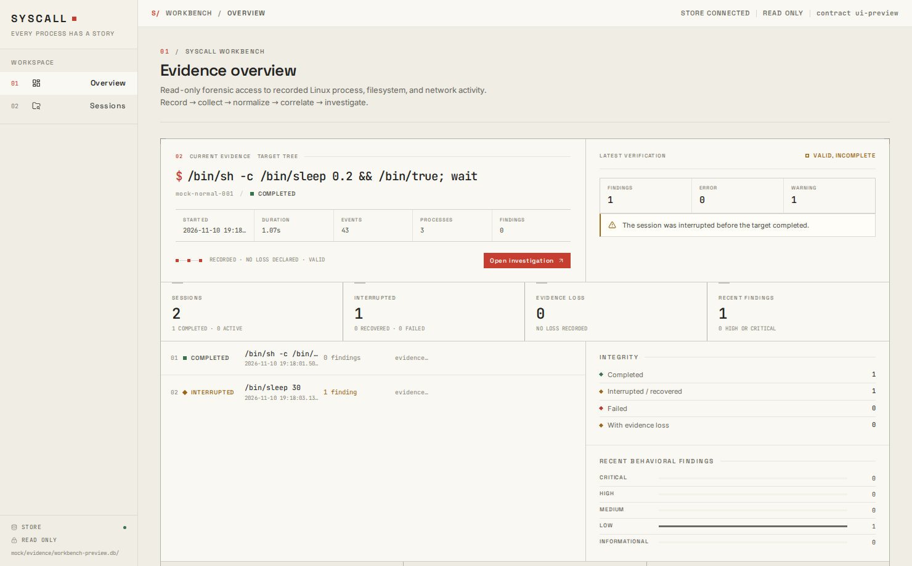

### Session browser

Server-side search over session id/command/arguments, status filter, sort direction, evidence
loss, verification assessment, and finding counts. The table is bounded and reports the
matched count.

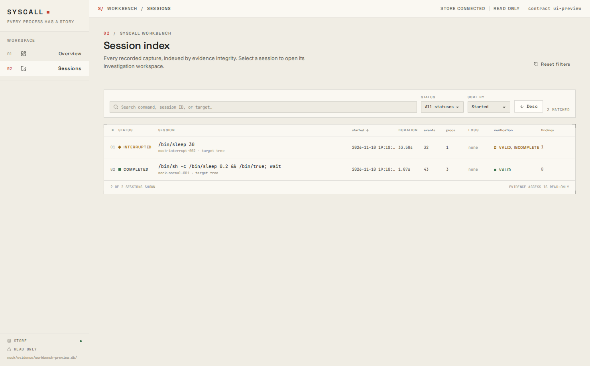

### Investigation summary

Per-session identity, collection accounting, event composition, verification summary, and
behavioral finding preview. Filtered-by-scope records are shown separately from collection
loss; unresolved identities are stated as an attribution limitation rather than evidence loss.

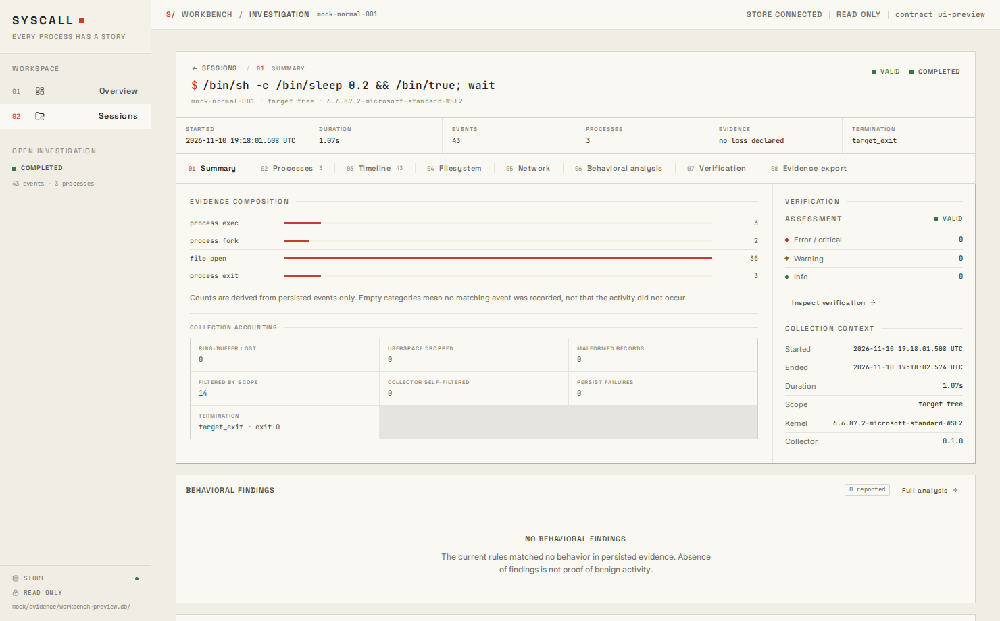

### Processes

Observed process tree with explicit unresolved ancestry/identity markers. Selecting a node
shows instance identity, lifetime, exit status, relationships, and provenance notes.

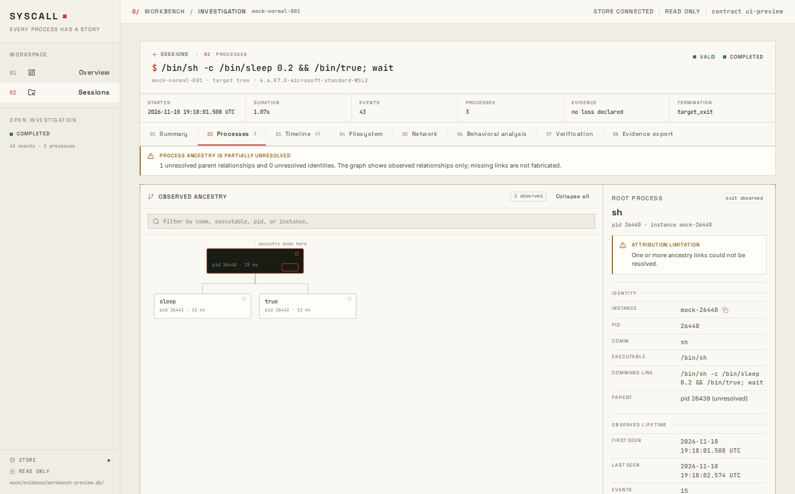

### Timeline

Paged event timeline with event type, process, path/address filtering, time bounds, and a
detail panel for recorded payload and provenance. The selected event remains addressable in
the URL.

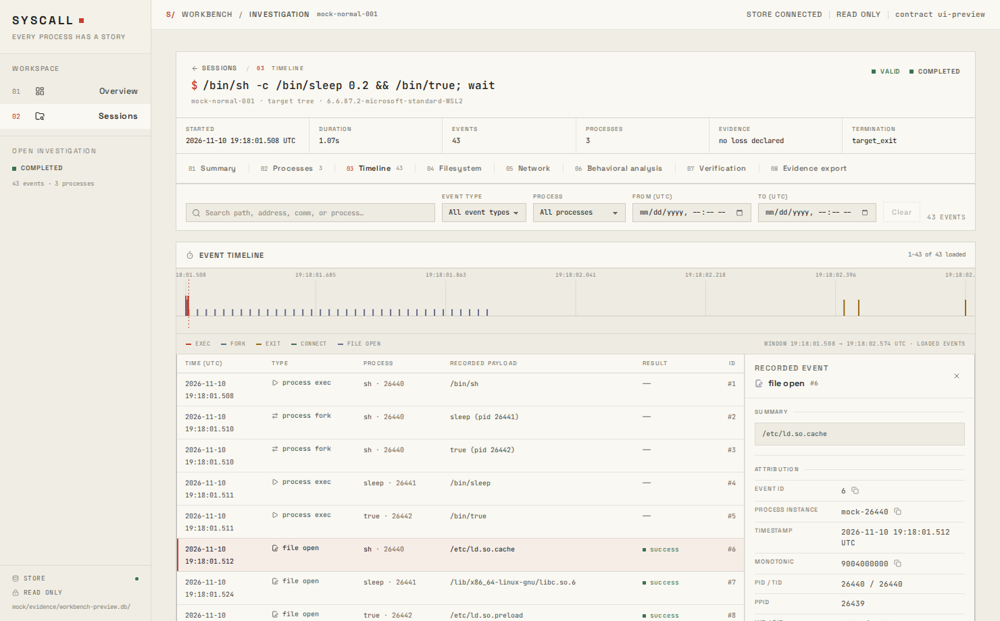

### Filesystem

`openat` attempts with absolute/relative path form, flags, success/errno, and attempt
semantics. A relative path is displayed as recorded, not resolved against an unknown cwd.

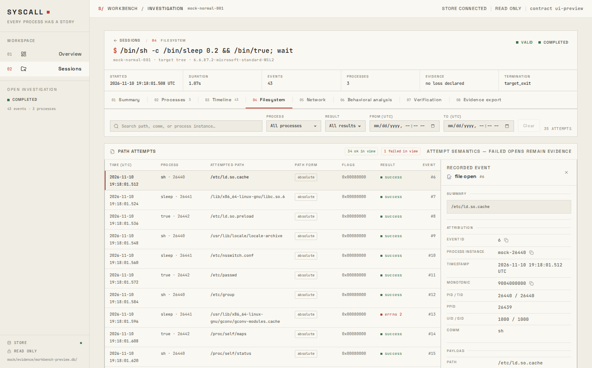

### Network

IPv4/IPv6 `connect` attempts only. The screen explicitly states that a successful `connect`
does not prove an established session, data transfer, or end-to-end reachability.

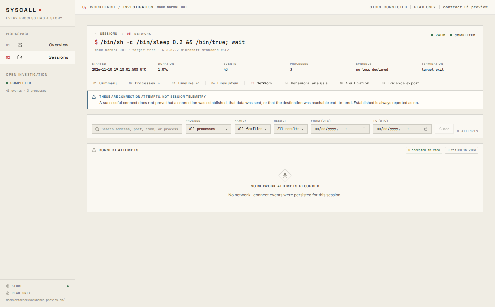

### Behavioral analysis

Existing deterministic findings, severity/confidence/rule filters, supporting event links,
related processes, next steps, limitations, and rule metadata.

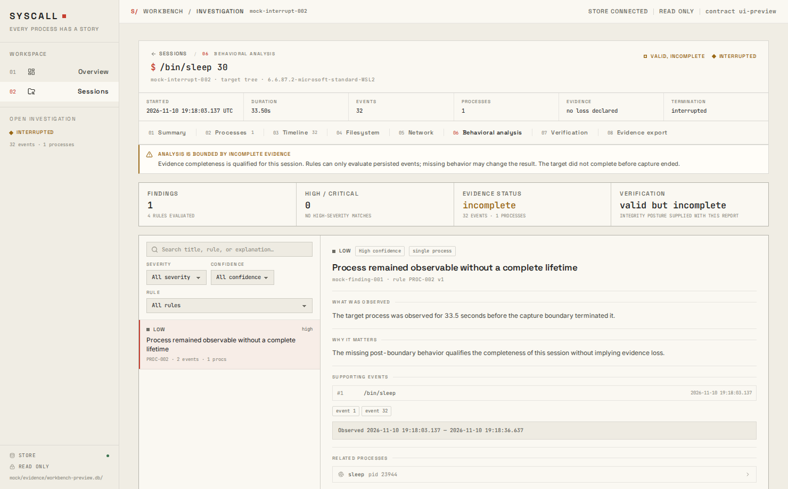

### Verification

Existing read-only verification assessment, findings, severity distribution, and
interpretation. Verification checks the stored record; it does not prove the truth of events
or completeness of collection.

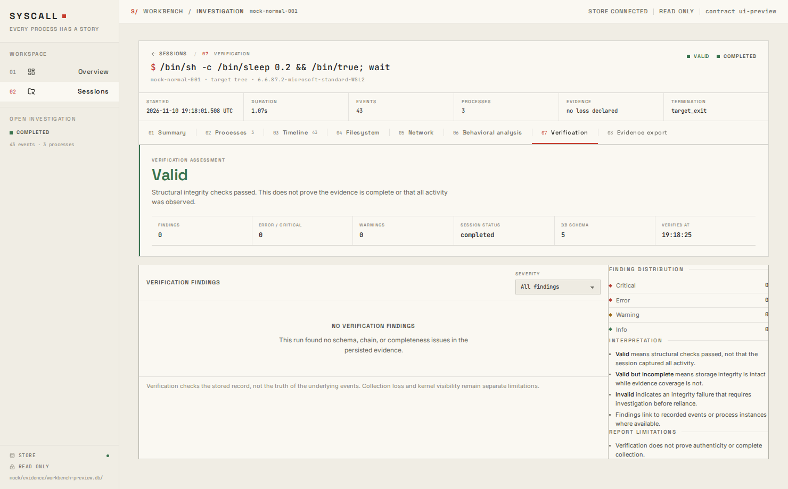

### Evidence export

The destination is selected by the Rust backend. The frontend cannot supply a path. Existing
files require an explicit replace confirmation. The manifest displays component SHA-256 and
byte length.

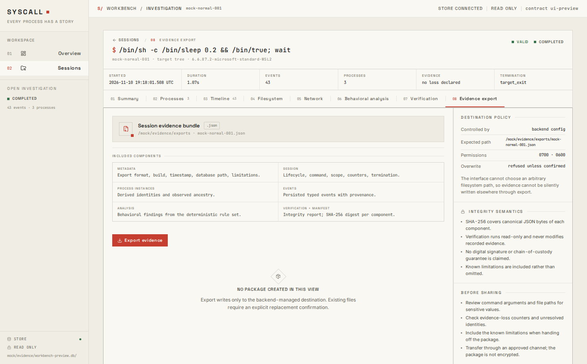

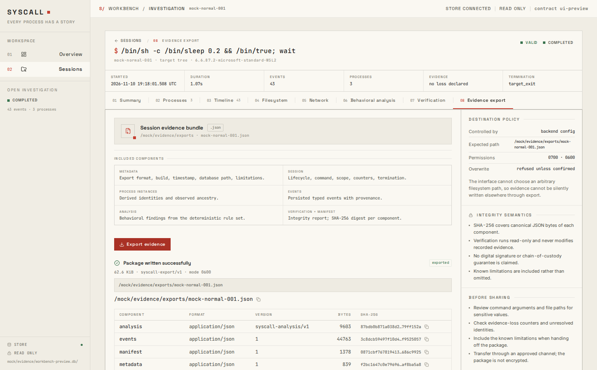

## 4. Tauri command contract

Contract version: `syscall-desktop/v2`. Every command except `app_info` is asynchronous and
runs database/analysis work on `spawn_blocking`. All request fields are camelCase.

| Command | Request | Response |
|---|---|---|
| `app_info` | none | `AppInfo` — contract version, database path/existence, read-only flag, export dir, recording support |
| `list_sessions` | `ListSessionsRequest` — limit, search, status, sortBy, sortDirection, includeIntelligence | `SessionListResponse` |
| `get_overview` | `OverviewRequest` — recentLimit | `OverviewResponse` |
| `get_session` | `SessionRequest` — sessionId | `SessionDetail` (session + stats) |
| `list_processes` | `SessionRequest` | `ProcessTreeResponse` |
| `query_timeline` | `TimelineRequest` — sessionId, eventType, pid, processInstanceId, fromNs, toNs, search, limit, offset | `TimelineResponse` |
| `query_filesystem` | `ActivityRequest` — sessionId, pid, processInstanceId, fromNs, toNs, success, search, limit, offset | `FileActivityResponse` |
| `query_network` | `ActivityRequest` — plus family | `ConnectionResponse` |
| `get_event` | `EventRequest` — sessionId, eventId | `EvidenceDetail` |
| `run_analysis` | `SessionRequest` | `AnalysisReport` (existing engine contract) |
| `run_verification` | `SessionRequest` | `SessionVerificationReport` (existing engine contract) |
| `export_session` | `ExportRequest` — sessionId, force | `ExportResult` — path, bytes, format, manifest |

Bounds and validation:

- Session list is capped at 500; page size is capped at 500; recent overview at 20.
- Search strings are limited to 200 characters.
- Session IDs reject empty, `"."`, `".."`, path separators, and overlong values.
- Status, sort, direction, and address family are normalized against fixed allowed sets.
- `get_event` requires both a session ID and event ID; a mismatched session returns no event.
- Errors are serialized as `{ code, message }`, for example `SESSION_NOT_FOUND`,
  `DATABASE_NOT_FOUND`, `INVALID_REQUEST`, `STORAGE_ERROR`, `ANALYSIS_ERROR`, `EXPORT_ERROR`.

## 5. Security model

### Read-only evidence access

- The desktop opens SQLite through `Storage::open_read_only`; it never inserts, updates,
  migrates, vacuums, or deletes evidence.
- The database path is fixed at process startup from `--db=<path>` / `--db <path>` or
  `SYSCALL_DB`. It is not accepted in any frontend request.
- Analysis, verification, and export all use the same selected database. Export writes a new
  package; it never modifies the source database.

### Frontend boundary

- `src/lib/api.ts` is the only source module importing `@tauri-apps/api/core`. A security test
  scans the source tree for violations.
- No arbitrary SQL, shell, filesystem, dialog, or HTTP plugin is installed or exposed.
- The capability file grants only `core:default` to the `main` window.
- CSP: default/script/style/image/font/connect restricted to the app and Tauri IPC; no remote
  script, frame, or network origins.
- Untrusted event strings are rendered as React text. There is no
  `dangerouslySetInnerHTML` and raw payloads are shown in text blocks.
- Clipboard copy is user-initiated and reads text already rendered by the app.

### Export boundary

- Destination is `~/.local/share/syscall/exports/<session-id>.json`, or
  `SYSCALL_EXPORT_DIR` when the operator sets it. The frontend cannot override either.
- Export refuses to replace an existing file unless `force: true`, which the UI asks for
  explicitly after showing the existing-file error.
- The exporter creates the directory with mode `0700` and the package with mode `0600`.
- The manifest contains SHA-256 digests of canonical JSON components. This is integrity
  evidence, not a signature or a chain-of-custody guarantee.

### Why there is no record button

Recording requires loading/attaching eBPF with privilege. The existing recorder deliberately
drops privilege before creating the database or spawning the target. A desktop button would
need one of:

1. the whole GUI running as root, which violates the requirement and expands the attack
   surface;
2. embedded or cached sudo credentials, which the project forbids;
3. a separate privileged helper with authenticated, narrowly scoped IPC and lifecycle
   management.

Option 3 was not present in the existing system and was not invented for Phase 7. The workbench
therefore reports `recording_supported: false` and exposes no recording controls. Operators
record with the CLI and open the resulting database read-only.

## 6. Data and rendering semantics

- Counts represent persisted rows. Empty categories mean no matching event was recorded, not
  that the activity did not occur.
- `filtered_events` are out-of-scope events rejected by target-tree attribution. They are shown
  as **Filtered by scope** and do not by themselves mean evidence loss.
- Unresolved identity/ancestry is surfaced as an attribution limitation. It qualifies evidence
  completeness but is not presented as dropped or lost records.
- Verification assessment is the existing engine result. `VALID` means structural checks
  passed; it does not mean collection was complete.
- Behavioral findings are deterministic indicators with stated limitations, not verdicts.
- A connect event proves an attempt. `established` is always reported as `false` by the current
  collector and the UI never upgrades an attempt to a session.
- Relative file paths are shown as recorded. The collector does not resolve them against a cwd.

## 7. Build and run

### Ubuntu 24.04 / WSL2 prerequisites

```bash
sudo apt update
sudo apt install -y \
  build-essential curl wget file \
  libwebkit2gtk-4.1-dev libgtk-3-dev libayatana-appindicator3-dev \
  librsvg2-dev libxdo-dev libssl-dev
```

Node.js 20+ and a current Rust stable toolchain are required. Verify WSLg displays:

```bash
echo "$DISPLAY $WAYLAND_DISPLAY"
ls /mnt/wslg
```

### Development

```bash
cd desktop
npm install
npm run tauri:dev
```

`tauri dev` starts Vite on `127.0.0.1:1420` and launches the desktop window. A plain
`cargo build -p syscall-desktop` debug binary expects that dev server; it is not standalone.

### Release

```bash
cd desktop
npm run tauri:build -- --no-bundle
```

The binary is `target/release/syscall-workbench`. The Tauri CLI may print the package display
name (`syscall-desktop`) while the actual binary name is defined by the `[[bin]]` target.

Run against a recorded database:

```bash
target/release/syscall-workbench --db="$HOME/.local/share/syscall/e2e-<id>.db"
# or
SYSCALL_DB="$HOME/.local/share/syscall/e2e-<id>.db" target/release/syscall-workbench
```

On WSLg, if the window is blank:

```bash
WEBKIT_DISABLE_COMPOSITING_MODE=1 target/release/syscall-workbench --db=...
```

### Headless checks

These do not need GTK/WebKit:

```bash
cargo test -p syscall-desktop --no-default-features
npm --prefix desktop test
npm --prefix desktop run build
```

The `desktop-app` feature gates the Tauri runner. With default features, compiling the GUI
requires the system development packages; `scripts/check.sh` automatically falls back to the
headless service layer when `webkit2gtk-4.1` and `gtk+-3.0` are absent.

## 8. Verification performed

| Check | Result |
|---|---|
| `cargo fmt --all --check` | **PASS** |
| `cargo clippy --workspace --all-targets -- -D warnings` | **PASS** |
| `cargo test --workspace` | **PASS** — 203 tests |
| `cargo build -p syscall-cli` | **PASS** |
| `scripts/check.sh` | **PASS** — includes eBPF build, skeleton, and BTF layout checks |
| `npm --prefix desktop run build` | PASS |
| `npm --prefix desktop test` | PASS — 30 tests |
| `cargo test -p syscall-desktop --no-default-features` | PASS — 8 tests |
| `cargo check -p syscall-desktop --all-targets` | PASS (with staged Ubuntu headers) |
| `npm --prefix desktop run tauri:build -- --no-bundle` | PASS |
| Release launch under WSLg | PASS — all ten screens plus export result captured |
| GUI export | PASS — 64,138-byte package, mode `0600`, manifest rendered |

`cargo test --workspace` and workspace clippy were run with the staged Ubuntu headers (and
`LD_LIBRARY_PATH` for the GUI-linked test binary). `scripts/check.sh` ran without the staged
headers in its headless branch and passed; it compiled the GUI only if the system packages are
installed.

The service tests create real temporary SQLite databases, insert sessions/events through
`syscall-storage`, and exercise session filtering, process trees, timeline pagination, event
lookup, filesystem/network semantics, analysis, verification, export overwrite behavior, and
structured errors. They do not use a mocked database.

## 9. Known limitations

- **System packages are not installed on this host.** The release was validated with packages
  staged under `target/desktop-deps` (removed afterward); install the dependencies in section 7
  for a normal run.
- **Read-only only.** Recording from the GUI is intentionally absent. See section 5.
- **No automatic schema migration for old databases.** Read-only open does not migrate. Use a
  database produced by the current collector/storage schema. The demonstration database is
  schema v4 and verification reports that value honestly.
- **No OS-level sandbox around the renderer beyond Tauri capabilities/CSP.** Do not add remote
  content or untrusted plugins.
- **Export destination is fixed** to the backend-managed directory; there is no save dialog.
- **No signed/notarized package** and no installer was produced (`--no-bundle` release binary).
- **No automated GUI end-to-end test.** The release build and export were exercised manually
  against a real database. The current interface screenshots use the standalone renderer's
  preview dataset; backend and component behavior are covered by tests.
- **WSLg software rendering** was used. GPU acceleration and accessibility-bus integration
  were unavailable.
- **Large sessions:** analysis and export are bounded by the existing engines; the UI pages
  timeline/filesystem/network results but does not virtualize the entire database.
